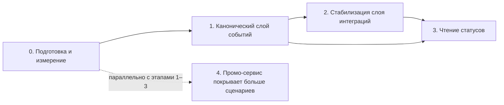

# Дорожная карта миграции

Исходные данные: точки трансформации и целевая архитектура первого этапа – [Task3](../Task3/transformation.md).

## Паспорт

| Поле | Значение |
|---|---|
| Горизонт планирования | 9 месяцев: первые 3 месяца года уходят на изучение платформы, этапы 0–4 укладываются в оставшиеся 9 месяцев, каждый квартал бизнес видит пользу. Первый квартал – этапы 0 и 1 и параллельно этап 4: промо-сервис снижает операционный шум из-за некорректного подсчёта суммы. Второй – этап 2: меньше дублей заявок. Третий – этап 3: меньше обращений из-за статуса. |
| Стратегия миграции | Incremental Migration – поэтапный переход. |
| Ключевые паттерны | ACL – канонический слой событий (точка 4). Event-Driven – слой публикует события заказа в брокер, интеграции и аналитика получают их по подписке (точки 4 и 1). Strangler Fig – промо-сервис по частям забирает расчёт скидки у пакета `legacy_promo_pkg` в Oracle, а какой расчёт считает скидку, решает Pricing & Promo Logic в монолите (точка 3). |

## Краткое резюме

Миграция выполняется инкрементально, потому что замена всего сразу несёт высокий риск сбоя и сложный откат. До разового перехода пришлось бы одновременно вести новый функционал и подготовку перехода, а сам переход разом требует остановки, которую бизнес не допускает. Сначала команда замеряет базовые значения метрик и проверяет, что все, кто меняет статус, обновляют время изменения, затем запускает канонический слой событий, после этого стабилизирует интеграции и только затем переводит чтение статусов клиента и поддержки на слой. Промо-сервис расширяется параллельно: он обособлен и мало влияет на правки статуса. Такой порядок выбран из-за зависимостей: слой увидит все смены статусов, только если все, кто меняет статус, обновляют время изменения; интеграции и чтение статусов берут события и статусы из слоя; показывать клиенту статус можно, только когда интеграции стабилизированы. Основные риски roadmap связаны с нагрузкой опроса на Oracle на распродажах, правкой писателей статусов и изменением обмена с .NET-сервисом через таблицу Oracle, поэтому для каждого этапа заданы критерии готовности и условия остановки.

## Этапы

### Этап 0. Подготовка и измерение

| Раздел | Содержание |
|---|---|
| Цель этапа | Подготовить запуск слоя событий: замерить базовые значения метрик и убедиться, что слой увидит все смены статусов. |
| Точки трансформации | Точки 1–4. |
| Основные работы | Замерить базовые значения: число обращений клиентов из-за непонятного статуса, время, за которое поддержка выясняет реальный статус заказа, число дублей заявок, которые поддержка разбирает вручную, число заказов, скидку для которых считает старая процедура в Oracle, время отклика Oracle, время ответа при оформлении и время вызова промо-сервиса на распродаже. Проверить, что у строк со статусом есть время изменения и его обновляют все, кто меняет статус, включая batch-процедуры и SQL-скрипты. Где время не обновляется – доработать скрипт и проверить его. |
| Промежуточное состояние | Система работает как в AS-IS: клиент и поддержка ничего нового не видят. Базовые значения метрик известны, все, кто меняет статус, обновляют время изменения. |
| Зависимости | Нет. |
| Риски | Доработка скрипта затрагивает писателей статусов, а их трогать опасно. |
| Условие остановки | После доработки скриптов число обращений из-за непонятного статуса или инцидентов со статусами выросло больше чем на N% относительно базового замера. |
| Критерии завершения | Базовые значения метрик замерены, все, кто меняет статус, обновляют время изменения. |

### Этап 1. Канонический слой событий

| Раздел | Содержание |
|---|---|
| Цель этапа | Повысить прозрачность данных для команды разработки: она знает, кто какие данные читает и откуда берутся поля, и меньше рискует что-то сломать на следующих этапах. |
| Точки трансформации | Точка 4. |
| Основные работы | Выделить единый набор бизнес-событий заказа и описать потоки данных: кто какие данные читает и откуда берутся поля. Запустить опрос таблиц Oracle с заданной частотой, сохранение последнего статуса в БД канонической модели и публикацию событий в брокер. Перевести аналитику на события по подписке, кроме тяжёлых отчётов. |
| Промежуточное состояние | Клиент и поддержка ничего не замечают. Слой событий опрашивает Oracle, хранит последний статус каждого заказа и публикует события в брокер. Аналитика получает события по подписке, тяжёлые отчёты по-прежнему читают Oracle. Потоки данных описаны. |
| Зависимости | Этап 0: базовые значения метрик замерены, все, кто меняет статус, обновляют время изменения. |
| Риски | Если опрашивать Oracle слишком часто, на распродажах проблема с откликом сохранится и даже усугубится. |
| Условие остановки | Время отклика Oracle на распродаже выросло больше чем на N% относительно базового замера. |
| Критерии завершения | Единый набор бизнес-событий выделен, потоки данных описаны, слой опрашивает Oracle и публикует события в брокер, аналитика получает их по подписке. |

### Этап 2. Стабилизация слоя интеграций

| Раздел | Содержание |
|---|---|
| Цель этапа | Более предсказуемая обработка заказов: меньше дублей заявок, которые поддержка разбирает вручную. |
| Точки трансформации | Точка 1. |
| Основные работы | Унифицировать события, убрать часть обмена через БД, выделить единый контракт статуса доставки. Обмен с партнёрами через общие таблицы Oracle заменить полноценной интеграцией с контрактом, события интеграции получают по подписке из слоя событий. |
| Промежуточное состояние | Интеграции получают события заказа по подписке из слоя и обмениваются с партнёрами по контракту, а не через общие таблицы Oracle. Выбор маршрута доставки и синхронные вызовы оформления – как в AS-IS. Клиент ничего не замечает, поддержка разбирает меньше дублей заявок. |
| Зависимости | Этап 1: интеграции переходят на канонический набор событий заказа. |
| Риски | Изменение обмена с .NET-сервисом через таблицу Oracle может сломать какую-то часть системы. Пока новую схему запускают по частям, может временно стать хуже видно, что происходит с заказом. |
| Условие остановки | Число дублей заявок, которые вручную разбирает поддержка, выросло больше чем на N% относительно базового замера. |
| Критерии завершения | Число дублей заявок, которые вручную разбирает поддержка, снизилось на N% относительно базового замера за одинаковые периоды спроса. |

### Этап 3. Чтение статусов

| Раздел | Содержание |
|---|---|
| Цель этапа | Более предсказуемая обработка заказов: клиент видит понятный статус и не обращается в поддержку. |
| Точки трансформации | Точка 2. |
| Основные работы | Добавить в слой событий чтение статусов: клиент и поддержка получают синхронным запросом человеческий понятный статус, по которому виден контекст заказа. |
| Промежуточное состояние | Клиент и поддержка получают статус у слоя синхронным запросом: понятный статус с контекстом заказа, с задержкой до одного интервала опроса. Если слой недоступен, они видят ошибку, а не неактуальный статус. Переходы статусов – как в AS-IS. |
| Зависимости | Этап 1: чтение статусов – часть слоя событий и берёт смены статусов прямо из него. Этап 2: интеграции стабилизированы, чтобы доверять каналам. |
| Риски | Рассинхрон сохранится: новое чтение может получать изменения с задержкой или не все. Клиент видит новый статус с задержкой до одного интервала опроса. Доверие клиента не восстановится. Если слой упадёт, клиент и поддержка не получат статус, но сразу увидят ошибку, а не неактуальный статус. |
| Условие остановки | Число обращений «почему статус не меняется или меняется странно» выросло больше чем на N% относительно базового замера. |
| Критерии завершения | Число обращений «почему статус не меняется или меняется странно» снизилось на N%, а время ответа поддержки по проблемным заказам сократилось на N% относительно базового замера за одинаковые периоды спроса. |

### Этап 4. Промо-сервис покрывает больше сценариев

| Раздел | Содержание |
|---|---|
| Цель этапа | Более предсказуемая обработка заказов: меньше риск некорректного подсчёта суммы. |
| Точки трансформации | Точка 3. |
| Основные работы | Перенести часть расчёта скидки из пакета `legacy_promo_pkg` в Oracle в промо-сервис, чтобы меньше заказов уходило в старый расчёт скидки. Монолит не меняется: `createOrder` по-прежнему сначала вызывает промо-сервис. |
| Промежуточное состояние | Промо-сервис считает скидку в большем числе сценариев, меньше заказов уходит в запасной расчёт скидки в Oracle. Надбавки в `createOrder` и запасной расчёт скидки остаются. Для клиента оформление не меняется. |
| Зависимости | Этап 0: базовые значения метрик замерены. От других этапов не зависит: промо-сервис обособлен и мало влияет на правки статуса, поэтому этап идёт параллельно с этапами 1–3. |
| Риски | Логику промо невозможно объяснить без конкретного кейса, поэтому при переносе сценария в промо-сервис можно упустить правило. Изменения в промо-сервисе могут ухудшить время ответа при оформлении: оформление вызывает его синхронно. |
| Условие остановки | Время ответа при оформлении на распродаже выросло больше чем на N% относительно базового замера. |
| Критерии завершения | Число заказов, скидку для которых считает старая процедура в Oracle, снизилось на N% относительно базового замера за одинаковые периоды спроса. |

## Зависимости между этапами

| Зависимость | Почему порядок жёсткий | Что будет, если нарушить порядок |
|---|---|---|
| Этап 0 до этапа 1 | Слой находит смены статусов по времени изменения, а метрики этапов сравниваются с базовыми замерами. | Слой не заметит часть смен статусов, и клиент позже увидит неактуальный статус. Улучшение или ухудшение не с чем сравнить. |
| Этап 1 до этапов 2 и 3 | Интеграции получают события из слоя, а чтение статусов берёт статусы из слоя. | Интеграциям не на что переходить, клиенту и поддержке не из чего отдавать статус. |
| Этап 2 до этапа 3 | Повторные отправки партнёрам, дубли заявок и ручное восстановление статуса после сбоев интеграций попадают в статус заказа. | Клиент видит в новом понятном статусе шум интеграций. |

**Параллельно.** Этап 4 идёт параллельно с этапами 1–3: промо-сервис обособлен и мало влияет на правки статуса. Чтобы при замедлении оформления понять, какой этап останавливать, отдельно замеряем, где основная задержка: в вызове промо-сервиса или в Oracle.

## Связь с планом переключения

| Ключевой переход | Этап | Почему нужен отдельный план |
|---|---|---|
| Запуск канонического слоя событий | Этап 1 | Самый важный переход: от него строится вся остальная работа, интеграции и чтение статусов берут события и статусы из слоя. План – в [cutover-plan.md](cutover-plan.md). |
